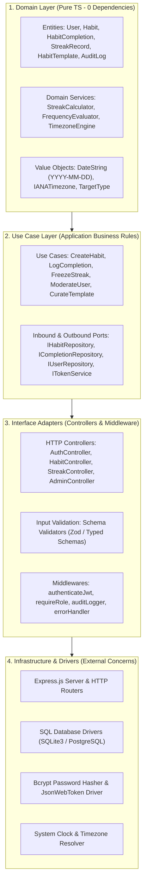
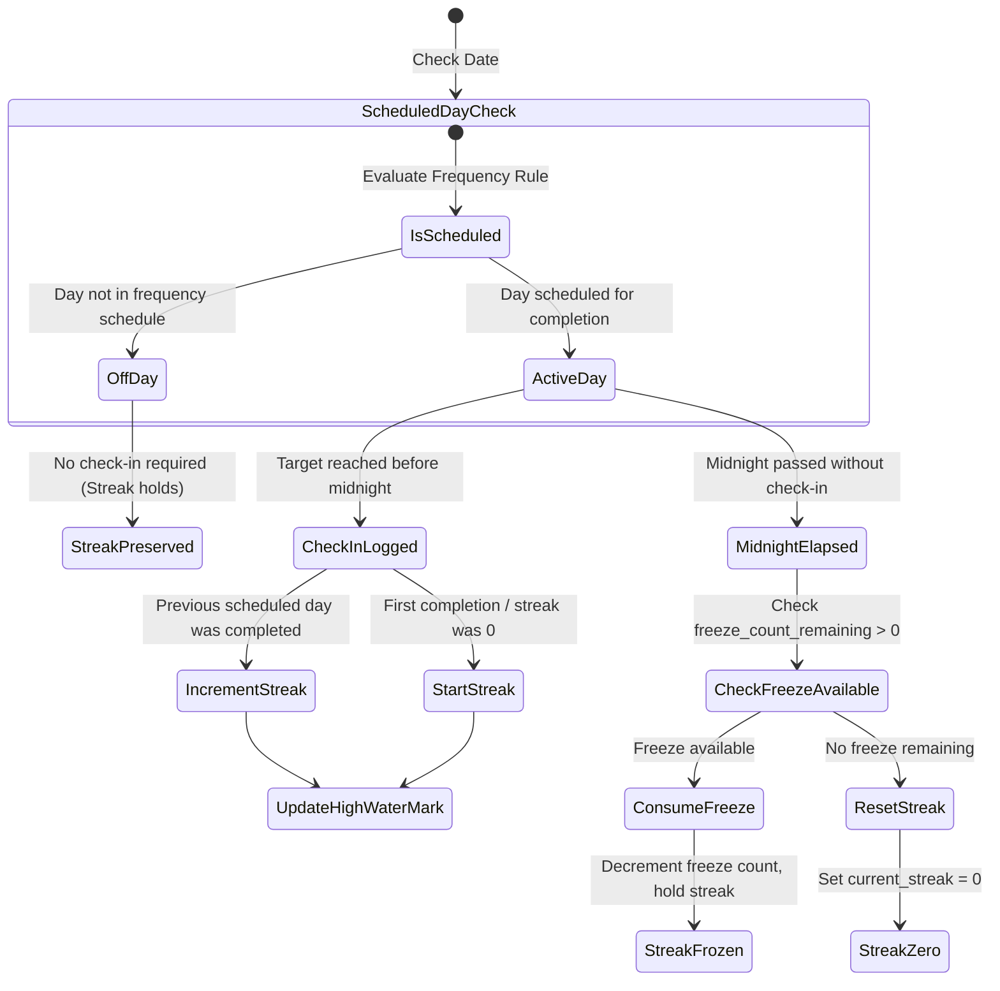
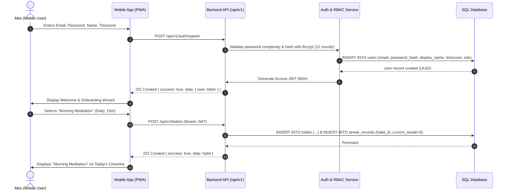
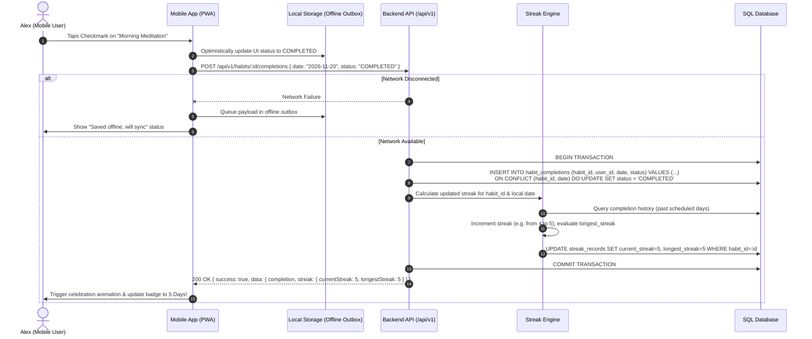
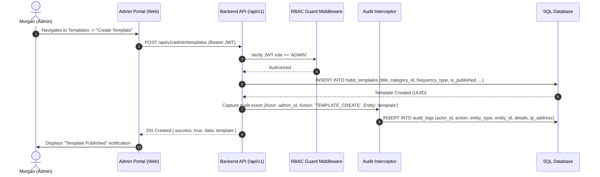

# System Architecture & Detailed Technical Design
## Enterprise Daily Habit Tracker Ecosystem

**Document Version:** 1.0.0  
**Status:** Approved (Gate 2 Architecture Baseline)  
**Author:** System Architect (@architect)  
**Target Delivery:** Q1 2027  

---

## 1. System Topology & High-Level Architecture

The Daily Habit Tracker ecosystem is structured as a modular monorepo partitioned into three decoupled functional domains:
1. **Mobile Client Application (`mobile-app/`)**: Cross-platform mobile application built with React Native (Expo / TypeScript) delivering low-friction daily check-ins, visual streak tracking, calendar heatmaps, and offline check-in queuing with AsyncStorage.
2. **Administrative Web Portal (`admin/`)**: High-density operational dashboard for platform analytics, user moderation, curated template management, and security audit log inspection.
3. **Backend Modular API (`backend/`)**: High-performance Node.js / Express REST API implementing Clean Architecture (Ports & Adapters), strict static typing, deterministic timezone streak calculation, and ACID persistence.

```mermaid
flowchart TD
    subgraph Clients["Client Tier"]
        Mobile["Mobile App (React Native / Expo)<br>iOS, Android & Web<br>End-User Check-in & Analytics"]
        Admin["Admin Portal (Next.js + React)<br>Port: 3001<br>Platform Moderation & Curation"]
    end

    subgraph Gateway["HTTP Gateway & Security"]
        RateLimit["Rate Limiter (express-rate-limit)"]
        CorsHelmet["CORS & Helmet Security Headers"]
        AuthMiddleware["JWT Authentication & RBAC Guard"]
    end

    subgraph BackendCore["Backend Tier (Clean Architecture)"]
        Controllers["Interface Adapters / Controllers<br>(Auth, Habits, Streaks, Admin)"]
        UseCases["Application Use Cases<br>(Orchestration & DTO Mapping)"]
        DomainCore["Domain Model & Core Engines<br>(Streak State Machine, Timezone Resolver)"]
        Repos["Repository Ports & Data Adapters"]
    end

    subgraph DataStorage["Data Persistence Tier"]
        DB[(SQL Database<br>SQLite for Dev/Test | PostgreSQL for Prod)]
        Migrations["Reversible Migrations Engine<br>(Forward & Rollback Scripts)"]
    end

    Mobile -->|HTTPS / REST + JWT| RateLimit
    Admin -->|HTTPS / REST + Admin JWT| RateLimit
    RateLimit --> CorsHelmet
    CorsHelmet --> AuthMiddleware
    AuthMiddleware --> Controllers
    Controllers --> UseCases
    UseCases --> DomainCore
    UseCases --> Repos
    Repos --> DB
    Migrations --> DB
```

---

## 2. Modular Boundaries & Clean Architecture Layering

The backend codebase is organized according to Clean Architecture / Hexagonal principles. Outer layers depend inward on inner layers; inner layers are completely agnostic of outer infrastructure frameworks.



### 2.1 Backend Directory Structure
```
backend/
├── src/
│   ├── domain/                         # Domain Entities & Pure Logic
│   │   ├── entities/
│   │   │   ├── user.entity.ts
│   │   │   ├── habit.entity.ts
│   │   │   ├── completion.entity.ts
│   │   │   ├── streak.entity.ts
│   │   │   ├── template.entity.ts
│   │   │   └── audit-log.entity.ts
│   │   ├── services/
│   │   │   ├── streak-calculator.ts    # Deterministic streak logic
│   │   │   ├── frequency-evaluator.ts  # Daily vs Weekly frequency checks
│   │   │   └── timezone-resolver.ts    # IANA timezone & midnight calculation
│   │   └── value-objects/
│   │       ├── date-string.vo.ts
│   │       └── frequency-type.vo.ts
│   ├── usecases/                       # Interactors & Application Ports
│   │   ├── auth/                       # Register, Login, Refresh, Me
│   │   ├── habits/                     # Create, Update, Archive, List
│   │   ├── completions/                # LogCompletion, RemoveCompletion
│   │   ├── streaks/                    # GetStreak, FreezeStreak
│   │   ├── analytics/                  # UserSummary, HeatmapData
│   │   ├── templates/                  # ListTemplates, AdoptTemplate
│   │   ├── admin/                      # DashboardMetrics, ManageUsers, ManageTemplates
│   │   └── ports/                      # Repositories & Service interfaces
│   ├── controllers/                    # Express HTTP Controllers & Routers
│   │   ├── auth.controller.ts
│   │   ├── habit.controller.ts
│   │   ├── completion.controller.ts
│   │   ├── streak.controller.ts
│   │   ├── analytics.controller.ts
│   │   ├── template.controller.ts
│   │   └── admin.controller.ts
│   ├── infrastructure/                 # Concrete Implementations
│   │   ├── database/
│   │   │   ├── connection.ts           # SQLite / PostgreSQL pool
│   │   │   ├── migration-runner.ts     # Automated reversible runner
│   │   │   └── repositories/           # SqlUserRepository, SqlHabitRepository, etc.
│   │   ├── security/
│   │   │   ├── jwt-token.service.ts
│   │   │   └── bcrypt-hasher.service.ts
│   │   └── clock/
│   │       └── system-clock.service.ts
│   ├── middleware/                     # Express Middlewares
│   │   ├── auth.middleware.ts          # JWT bearer token parsing
│   │   ├── rbac.middleware.ts          # Role validation ('ADMIN' | 'USER')
│   │   ├── rate-limit.middleware.ts
│   │   ├── validation.middleware.ts
│   │   ├── audit.middleware.ts         # Administrative action interceptor
│   │   └── error.middleware.ts         # Standard error envelope
│   ├── config/                         # Environment & App Config
│   │   └── env.config.ts
│   ├── app.ts                          # Express application factory
│   └── server.ts                       # HTTP server entry point
├── migrations/                         # Versioned SQL migrations (up/down)
│   ├── 001_create_users_table.sql
│   ├── 002_create_categories_table.sql
│   ├── 003_create_habits_table.sql
│   ├── 004_create_completions_table.sql
│   ├── 005_create_streaks_table.sql
│   ├── 006_create_templates_table.sql
│   └── 007_create_audit_logs_table.sql
├── tests/
│   ├── unit/                           # Domain & Use Case tests
│   ├── integration/                    # Database repository & API route tests
│   └── contracts/                      # API spec verification tests
├── package.json
└── tsconfig.json
```

### 2.2 Client Module Architecture

#### Admin Portal (`admin/`)
- **Technology:** Next.js, React, TypeScript, Tailwind CSS, Lucide icons.
- **Routing:** Next.js App Router with route protection verifying admin role.
- **State Management:** TanStack Query (React Query) for server caching, optimistic invalidation, and automated refetching; React Context for authentication session.
- **Key Views:**
  1. `/admin/login`: Secure administrator sign-in.
  2. `/admin/dashboard`: Platform KPI cards (DAU/MAU, completion velocity, active streaks, registration volume) with interactive trend charts.
  3. `/admin/users`: Searchable and filterable user moderation table with status toggling (`ACTIVE` <-> `SUSPENDED`) and audit reason capture.
  4. `/admin/templates`: Habit template catalog manager (Create, Edit, Publish/Unpublish, Delete).
  5. `/admin/audit-logs`: Immutable audit log inspector with filterable actor, action, date range, and JSON diff preview.

#### Mobile Application (`mobile-app/`)
- **Technology:** React Native (Expo SDK), React, TypeScript.
- **Design Specifications:** Responsive mobile layouts, accessible touch targets (>= 44x44px), WCAG AA color contrast ratio.
- **Offline & Optimistic Strategy:**
  - Optimistic UI updates on habit toggle for zero perceived latency (<100ms).
  - Outbox synchronization queue (`AsyncStorage` backed): if network fails, check-in requests are queued and automatically retried upon reconnection.
- **Key Views:**
  1. `/today`: Daily actionable checklist, quick completion toggle, today's streak badges.
  2. `/habits`: Habit list, category filter, custom habit creation modal with frequency and reminder configuration.
  3. `/discover`: Browse and 1-tap adopt curated habit templates.
  4. `/analytics`: Calendar completion heatmap, weekly/monthly completion rates, milestone badge showcase.
  5. `/profile`: User settings, display name, timezone selector, notification preferences.

---

## 3. Core Domain Engines & Business Logic

### 3.1 Timezone-Aware Streak Engine

Streak calculation must be 100% deterministic and immune to server time variations.

#### Principles of Operation:
1. **Local Date Resolution:**
   - Every user has an assigned IANA timezone (e.g. `America/New_York`, `Asia/Tokyo`, `Europe/London`).
   - When checking in, the client supplies the target `date` (`YYYY-MM-DD`). The server validates that the requested date does not exceed the user's localized "today" and is within the allowed 48-hour historical backfill window (`today - 2 days <= date <= today`).
2. **Frequency Evaluation:**
   - **`DAILY`**: Habit is expected every single calendar day.
   - **`WEEKLY_DAYS`**: Habit is scheduled on specific days of the week (e.g., `[1, 3, 5]` for Mon, Wed, Fri where 0=Sunday, 1=Monday).
     - Non-scheduled days are treated as **Off Days**: they do not break a streak, nor do they require completion.
   - **`TIMES_PER_PERIOD`**: e.g., target 3 times per calendar week.
3. **Streak Calculation State Machine:**
   Let $D_{today}$ be the user's localized date.
   - If habit was completed for $D_{today}$:
     - If previous scheduled active day was completed, increment streak: $S_{current} = S_{prev} + 1$.
     - If no previous completion, $S_{current} = 1$.
   - If habit was NOT completed for $D_{today}$:
     - If today is currently underway (before midnight in user's timezone), the streak from yesterday remains intact: $S_{current} = S_{yesterday}$.
     - If yesterday was also missed:
       - Check `freeze_count_remaining`:
         - If $freeze\_count > 0$, consume 1 freeze, preserve streak, and log streak freeze event.
         - If $freeze\_count == 0$, reset streak: $S_{current} = 0$.
   - Longest Streak update: $S_{longest} = \max(S_{longest}, S_{current})$.



### 3.2 Idempotent Check-in Engine
- Check-ins are keyed on `(habit_id, date)`.
- Concurrent or duplicate submissions are handled gracefully via SQL `ON CONFLICT (habit_id, date) DO UPDATE` (or atomic check + insert/update inside a database transaction).
- For `BOOLEAN` habits: Toggling completes or uncompletes the record.
- For `NUMERIC` habits: Incremental progress or absolute updates are recorded. When `recorded_value >= target_value`, status transitions to `COMPLETED`.

---

## 4. End-to-End Sequence Diagrams

### 4.1 User Authentication & First Habit Creation Flow


### 4.2 Daily Check-In & Streak Recalculation Flow


### 4.3 Administrator Moderation & Template Management with Audit Trail


---

## 5. Complete Database Schema (DDL) & Indexing

The schema is written in strict ANSI-compliant SQL, ensuring seamless execution on SQLite3 (for fast unit/integration testing) and PostgreSQL (for production).

```sql
-- 001_create_users_table.sql
CREATE TABLE users (
    id VARCHAR(36) PRIMARY KEY,
    email VARCHAR(255) NOT NULL UNIQUE,
    password_hash VARCHAR(255) NOT NULL,
    display_name VARCHAR(100) NOT NULL,
    role VARCHAR(20) NOT NULL DEFAULT 'USER',       -- 'USER' | 'ADMIN'
    status VARCHAR(20) NOT NULL DEFAULT 'ACTIVE',   -- 'ACTIVE' | 'SUSPENDED'
    timezone VARCHAR(50) NOT NULL DEFAULT 'UTC',
    created_at TIMESTAMP NOT NULL DEFAULT CURRENT_TIMESTAMP,
    updated_at TIMESTAMP NOT NULL DEFAULT CURRENT_TIMESTAMP
);

CREATE INDEX idx_users_email ON users(email);
CREATE INDEX idx_users_status ON users(status);

-- 002_create_categories_table.sql
CREATE TABLE categories (
    id VARCHAR(36) PRIMARY KEY,
    name VARCHAR(50) NOT NULL UNIQUE,
    icon VARCHAR(50) NOT NULL,
    color VARCHAR(20) NOT NULL,
    is_system BOOLEAN NOT NULL DEFAULT 1,
    created_at TIMESTAMP NOT NULL DEFAULT CURRENT_TIMESTAMP
);

-- 003_create_habits_table.sql
CREATE TABLE habits (
    id VARCHAR(36) PRIMARY KEY,
    user_id VARCHAR(36) NOT NULL,
    category_id VARCHAR(36) NOT NULL,
    title VARCHAR(100) NOT NULL,
    description TEXT,
    frequency_type VARCHAR(30) NOT NULL DEFAULT 'DAILY', -- 'DAILY', 'WEEKLY_DAYS', 'TIMES_PER_PERIOD'
    frequency_payload TEXT,                             -- JSON encoded: e.g. [1,3,5]
    target_type VARCHAR(20) NOT NULL DEFAULT 'BOOLEAN',  -- 'BOOLEAN', 'NUMERIC'
    target_value DECIMAL(10, 2),
    unit VARCHAR(30),
    reminder_time VARCHAR(5),                           -- 'HH:mm'
    color VARCHAR(20) NOT NULL,
    icon VARCHAR(50) NOT NULL,
    is_archived BOOLEAN NOT NULL DEFAULT 0,
    created_at TIMESTAMP NOT NULL DEFAULT CURRENT_TIMESTAMP,
    updated_at TIMESTAMP NOT NULL DEFAULT CURRENT_TIMESTAMP,
    FOREIGN KEY (user_id) REFERENCES users(id) ON DELETE CASCADE,
    FOREIGN KEY (category_id) REFERENCES categories(id)
);

CREATE INDEX idx_habits_user_archived ON habits(user_id, is_archived);
CREATE INDEX idx_habits_category ON habits(category_id);

-- 004_create_completions_table.sql
CREATE TABLE habit_completions (
    id VARCHAR(36) PRIMARY KEY,
    habit_id VARCHAR(36) NOT NULL,
    user_id VARCHAR(36) NOT NULL,
    date VARCHAR(10) NOT NULL,                          -- 'YYYY-MM-DD'
    status VARCHAR(20) NOT NULL DEFAULT 'COMPLETED',    -- 'COMPLETED', 'SKIPPED'
    value DECIMAL(10, 2) DEFAULT 0,
    notes TEXT,
    completed_at TIMESTAMP NOT NULL DEFAULT CURRENT_TIMESTAMP,
    created_at TIMESTAMP NOT NULL DEFAULT CURRENT_TIMESTAMP,
    updated_at TIMESTAMP NOT NULL DEFAULT CURRENT_TIMESTAMP,
    FOREIGN KEY (habit_id) REFERENCES habits(id) ON DELETE CASCADE,
    FOREIGN KEY (user_id) REFERENCES users(id) ON DELETE CASCADE,
    CONSTRAINT uq_habit_date UNIQUE (habit_id, date)
);

CREATE INDEX idx_completions_habit_date ON habit_completions(habit_id, date);
CREATE INDEX idx_completions_user_date ON habit_completions(user_id, date);

-- 005_create_streaks_table.sql
CREATE TABLE streak_records (
    id VARCHAR(36) PRIMARY KEY,
    habit_id VARCHAR(36) NOT NULL UNIQUE,
    current_streak INTEGER NOT NULL DEFAULT 0,
    longest_streak INTEGER NOT NULL DEFAULT 0,
    last_completed_date VARCHAR(10),                    -- 'YYYY-MM-DD'
    freeze_count_remaining INTEGER NOT NULL DEFAULT 1,
    updated_at TIMESTAMP NOT NULL DEFAULT CURRENT_TIMESTAMP,
    FOREIGN KEY (habit_id) REFERENCES habits(id) ON DELETE CASCADE
);

CREATE INDEX idx_streaks_habit_id ON streak_records(habit_id);

-- 006_create_templates_table.sql
CREATE TABLE habit_templates (
    id VARCHAR(36) PRIMARY KEY,
    title VARCHAR(100) NOT NULL,
    description TEXT NOT NULL,
    category_id VARCHAR(36) NOT NULL,
    frequency_type VARCHAR(30) NOT NULL DEFAULT 'DAILY',
    frequency_payload TEXT,
    target_type VARCHAR(20) NOT NULL DEFAULT 'BOOLEAN',
    target_value DECIMAL(10, 2),
    unit VARCHAR(30),
    icon VARCHAR(50) NOT NULL,
    color VARCHAR(20) NOT NULL,
    is_published BOOLEAN NOT NULL DEFAULT 1,
    created_by VARCHAR(36) NOT NULL,
    created_at TIMESTAMP NOT NULL DEFAULT CURRENT_TIMESTAMP,
    updated_at TIMESTAMP NOT NULL DEFAULT CURRENT_TIMESTAMP,
    FOREIGN KEY (category_id) REFERENCES categories(id),
    FOREIGN KEY (created_by) REFERENCES users(id)
);

CREATE INDEX idx_templates_published ON habit_templates(is_published);

-- 007_create_audit_logs_table.sql
CREATE TABLE audit_logs (
    id VARCHAR(36) PRIMARY KEY,
    actor_id VARCHAR(36) NOT NULL,
    action VARCHAR(100) NOT NULL,
    entity_type VARCHAR(50) NOT NULL,
    entity_id VARCHAR(100) NOT NULL,
    details TEXT,                                       -- JSON metadata / before-after diff
    ip_address VARCHAR(45),
    created_at TIMESTAMP NOT NULL DEFAULT CURRENT_TIMESTAMP,
    FOREIGN KEY (actor_id) REFERENCES users(id)
);

CREATE INDEX idx_audit_logs_created_at ON audit_logs(created_at);
CREATE INDEX idx_audit_logs_actor ON audit_logs(actor_id);
```

---

## 6. Security Architecture & Threat Model (STRIDE)

| Threat Category | Potential Attack Vector | Architectural Mitigation |
| :--- | :--- | :--- |
| **Spoofing** | Forged identity tokens or session hijacking | HMAC-SHA256 signed JWTs with strict expiration (60m) and algorithm pinning. Passwords salted & hashed with Bcrypt (12 rounds). |
| **Tampering** | Parameter manipulation to access another user's habits | Strict tenancy boundary: all user queries append `WHERE user_id = :authUserId`. Parameterized queries prevent SQL injection. |
| **Repudiation** | Administrator denies performing destructive suspension | Immutable append-only `audit_logs` capturing admin actor ID, action name, entity ID, client IP, and diff payload. |
| **Information Disclosure** | Plaintext credential leaks, verbose stack traces in production | Uniform error envelope omitting internal stack traces in production; strict logging masking credentials and tokens. |
| **Denial of Service** | High-frequency API flooding or credential brute forcing | Tiered IP-based rate limiting (`express-rate-limit`): 100 req / 15 min for auth routes, 1000 req / 15 min for general API. |
| **Elevation of Privilege** | Standard user requesting admin API endpoints | RBAC middleware (`requireRole('ADMIN')`) verifying token claim before dispatching controller execution. |

---

## 7. Quality & Verification Gates (Gate 2 Checklist)

- [x] **Modular Boundaries**: Clear separation across `mobile-app/`, `admin/`, and `backend/`.
- [x] **Clean Architecture**: Domain layer free of third-party dependencies; Use Cases define clear Ports and DTOs.
- [x] **Streak Determinism**: Timezone resolution, midnight rollover, frequency schedules, and 48-hour backfill window fully specified.
- [x] **Data Integrity**: Idempotent check-ins enforced via composite uniqueness on `(habit_id, date)`.
- [x] **Reversible Migrations**: Complete DDL provided with dual SQLite3/PostgreSQL compatibility.
- [x] **Interface Contracts**: Pre-configured for comprehensive OpenAPI 3.1.0 specification in `docs/contracts/api-spec.json`.
